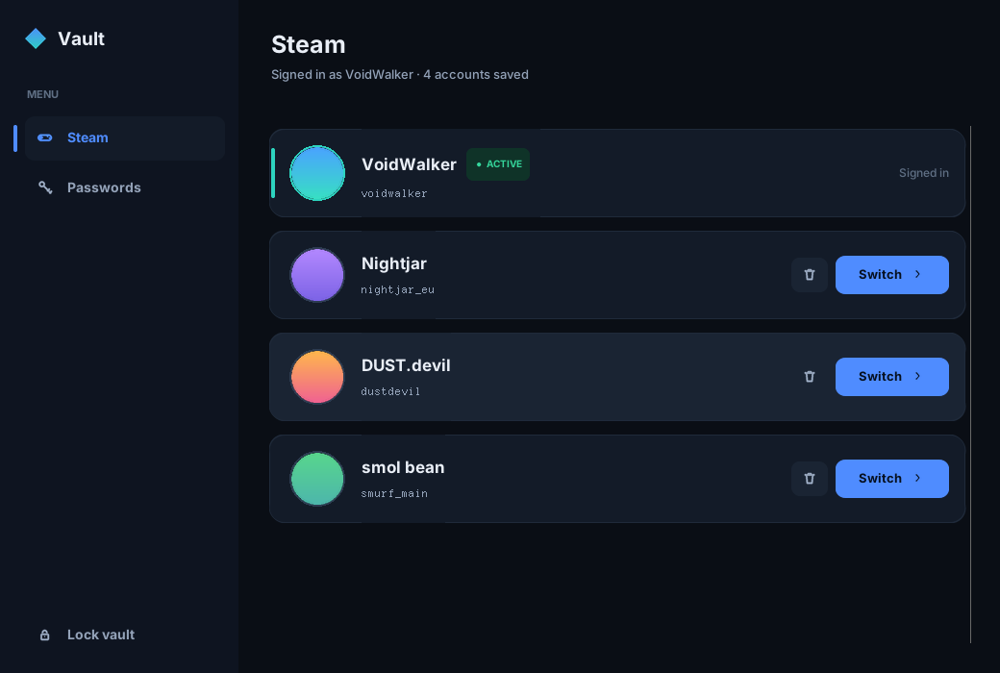
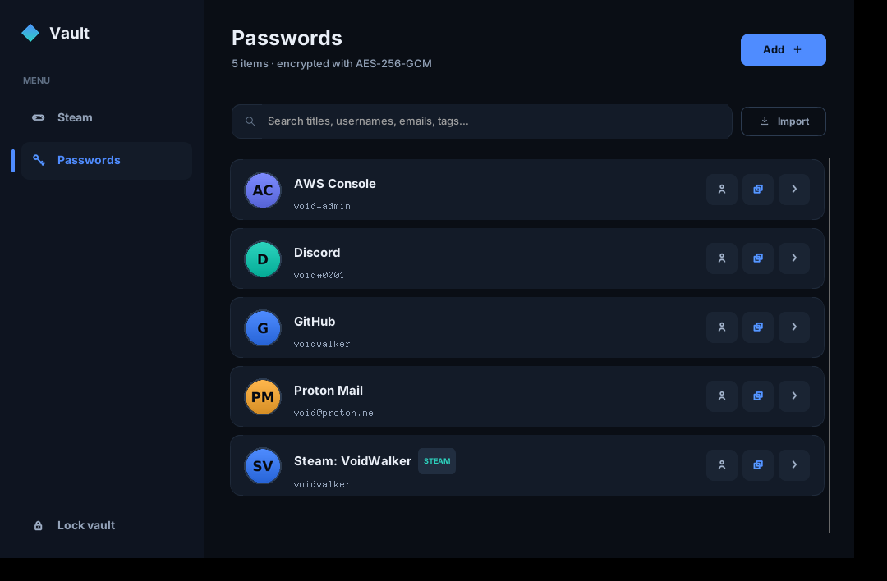
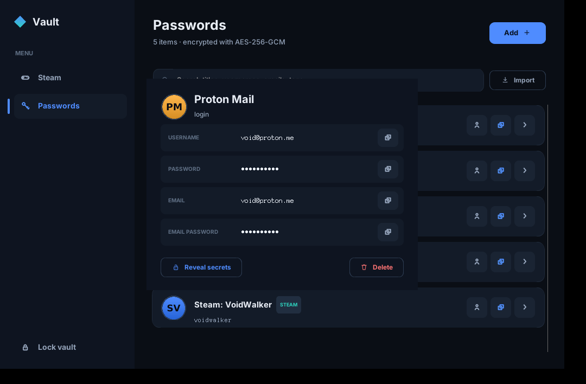

<div align="center">

# ◆ Vault

**A local, encrypted password vault with a one-click Steam account switcher.**

Dark, native desktop app · AES-256-GCM + Argon2id · no cloud, no telemetry, no accounts.



</div>

---

## What it does

- **Switch Steam accounts in one click.** Pick an account and Vault signs you in and restarts Steam for you — no retyping passwords. It uses Steam's *own* saved session tokens, the same mechanism as the open-source TcNo switcher.
- **Every account is remembered forever.** Each account you sign into is saved to a persistent roster — it stays in the list for one-click switching even after Steam itself forgets it. Vault also backs up each account's Steam session files while it's signed in and restores them on switch, so switching stays password-less.
- **Store logins, emails and notes**, encrypted with modern crypto. Search, reveal, copy-to-clipboard (auto-clears after 20s), generate strong passwords.
- **Bulk import** credentials in the `Login … Password : … Email Account : … Webmail : …` format, on one line or many.

| Passwords | Entry detail |
|---|---|
|  |  |

## Security

| Piece | Choice |
|-------|--------|
| Key derivation | **Argon2id** — `t=3`, `m=64 MiB`, `p=4`, random 16-byte salt per save |
| Encryption | **AES-256-GCM**, random 96-bit nonce per save |
| Integrity | the GCM tag authenticates the ciphertext **and** the header, so tampering — including a KDF-parameter downgrade — makes decryption fail |
| On disk | one JSON file, written atomically, `chmod 600`, previous version kept as `.bak` |

Your master password is never stored. If you forget it, the data is unrecoverable — that's the design.

## Install & run

### Windows (one click)
Download the folder and **double-click `Vault.bat`**. The first run sets up a local Python environment and installs dependencies; after that it just launches.

```
Vault.bat          install (first run) and start the app
Vault.bat build    build a standalone Vault.exe into dist\
Vault.bat test     run the test suite
```

### Any platform (manual)
```bash
pip install -r requirements.txt
python app.py
```
Requires Python 3.10+ (and Tk — bundled with python.org installers; on Linux `sudo apt install python3-tk`).

## How Steam switching works

Steam keeps a login session token for every account you've signed into on a machine. Vault switches by: gracefully closing Steam → setting `AutoLoginUser` + marking the account "most recent" → relaunching. Steam then signs in with its stored token.

- **Persistent roster + session backup:** accounts are saved to the vault and their Steam session files (`loginusers.vdf` + `ssfn*` machine-auth) are snapshotted to a `steam_sessions/` folder while signed in. On switch, Vault restores them, so the sign-in stays password-less.
- It only switches between accounts **already set up on your PC** (signed in once with *Remember me*). The one time Steam will still ask: if you fully sign an account out or Steam Guard revokes its session server-side, Steam requires a single re-login — a security limit no switcher can bypass. After that login, it's saved again.
- All changes are backed up (`*.vaultbak`) first, and Vault only ever copies/edits Steam's own files — never deletes them.
- **Windows:** `HKCU\Software\Valve\Steam` + `config\loginusers.vdf` · **Linux:** `~/.steam/registry.vdf` · **macOS:** `~/Library/Application Support/Steam/…`
- Set the `STEAM_ROOT` environment variable if Steam is installed somewhere unusual.

## Command line

Everything in the GUI is scriptable:

```bash
python vault.py init | add | list | show | search | edit | rm | import | gen | passwd | shell
python vault.py steam list | switch <account> | gui | shortcuts <dir> | link <account>
python steam.py  list | switch <account> | gui | shortcuts <dir>     # switcher, standalone
```

## Tests

```bash
python -m pytest -q      # crypto round-trips, tamper detection, parser, VDF, switching
```

## Scope

This manages **your own** accounts on **your own** computer. The Steam switcher cannot access an account you haven't already logged into in your Steam client; it only moves between existing local sessions. Don't use it with credentials that aren't yours.

## License

[MIT](LICENSE).

<div align="center"><sub>Built with Python · CustomTkinter · cryptography · argon2-cffi</sub></div>
